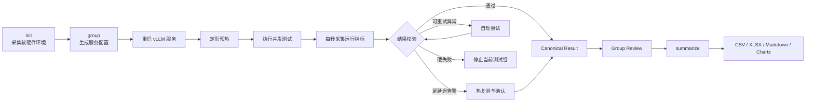

# Qwen3.6 27B vLLM-Ascend 性能基准与高并发参数调优

本项目实现了一套面向 Ascend NPU 和 vLLM 的可重复性能实验系统，用于研究 `max-num-seqs`、`max-num-batched-tokens`、输入长度和请求并发对推理吞吐、首 Token 延迟、单 Token 延迟及排队行为的影响。

系统覆盖环境采集、配置生成、服务重启、定形预热、重复测试、运行指标采样、异常判定、自动复测和结果汇总。当前归档包含 9 组服务配置、90 个测试场景和 270 条 canonical 结果。

生产 Baseline 为 `max-num-seqs=16`、`max-num-batched-tokens=8192`。测试结果表明，高并发瓶颈来自 `max-num-seqs` 小于实际并发所造成的排队，而不是 KV cache 容量不足。

## 实验系统架构



核心实现：

- `scripts/bench_matrix.sh`：管理初始化、服务配置、预热、测试和分组执行。
- `scripts/bench_report.py`：解析指标、判定异常、选择 canonical 结果并生成报告。
- `scripts/plot_results.py`：从中位数汇总生成 README 图表。
- `tests/`：验证参数修改、异常分类、重复结果聚合和报告结构。
- `analysis/`：保存实验结果、分组审计和运行证据。

## 测试矩阵

| 维度 | 测试值 |
|---|---|
| `max-num-seqs` | 16、24、32 |
| `max-num-batched-tokens` | 8192、12288、16384 |
| 输入长度 | 1024、4096 tokens |
| 输出长度 | 1024 tokens |
| 并发 | 1、5、10、16、32 |
| 每个场景重复次数 | 3 |
| 聚合方式 | 三次结果中位数 |

测试采用固定长度随机输入、固定 seed、温度 0、`request-rate=inf` 和 `ignore-eos`。每个场景发送 `5 × concurrency` 个请求，主要用于比较配置和观察突发负载下的系统上限。

最终归档包括 434 次实际尝试、270 条 canonical 结果和 90 行中位数汇总；测试请求失败、抢占和被排除结果均为 0。

## 核心结果

### 1. 吞吐随并发变化


并发不超过 16 时，三种 `max-num-seqs` 的差异有限；到 32 并发后，`max-num-seqs=16` 的吞吐开始回落，而 `max-num-seqs=32` 继续扩展。

### 2. 首 Token 延迟随并发变化


即使 `max-num-seqs` 已覆盖 32 并发，长输入下的 P95/P99 TTFT 仍明显增长。吞吐最优不代表尾延迟最优。

### 3. 单 Token 延迟


并发提升增加系统总吞吐，也会增加每个请求的生成延迟。TPOT 用于判断吞吐收益何时开始不足以抵消单请求体验下降。

### 4. 排队与调度上限


32 并发下，`max-num-seqs` 从 16 提升到 32 后，平均排队时间大幅下降。`waiting_peak` 受瞬时突发采样影响，不适合单独作为容量指标，应结合 queue mean 和 TTFT 判断。

补充视图：


## 三条主要发现

1. **`max-num-seqs` 是高并发场景的第一调优参数。** 32 并发下，将其从 16 提升到 32，跨输入长度和 batched-token 配置的平均吞吐由 `511` 提升到 `796 tok/s`，平均 P50 TTFT 由 `31.55` 秒下降到 `1.18` 秒。
2. **增大 `max-num-batched-tokens` 不会稳定提升性能。** 三个测试值的跨场景平均吞吐分别为 `367.74`、`365.56` 和 `360.89 tok/s`。应先确定并发上限，再根据输入长度微调该参数。
3. **吞吐最优不等于延迟最优。** 本次峰值为 `849.42 tok/s`，对应 `max-num-seqs=32`、`max-num-batched-tokens=12288`、输入 1024、并发 32；高并发长输入仍存在明显尾延迟。

## Baseline → Optimization

生产 Baseline 为 `seq=16, batched-tokens=8192`。对于同时覆盖 1024 和 4096 输入的服务，建议候选配置为 `seq=32, batched-tokens=16384`：它在 4096 输入下取得最高吞吐，在 1024 输入下的吞吐仅比全矩阵峰值低约 0.5%，同时避免维护两套工作负载配置。

下表比较相同硬件、模型、输出长度和 32 并发下的三次测试中位数：

| 输入 | 指标 | 生产 Baseline `16/8192` | 候选配置 `32/16384` | 变化 |
|---:|---|---:|---:|---:|
| 1024 | Output throughput | 517.20 tok/s | 844.89 tok/s | **+63.4%** |
| 1024 | P50 TTFT | 31.75 s | 0.73 s | **-97.7%** |
| 1024 | P99 TTFT | 36.50 s | 4.29 s | **-88.2%** |
| 1024 | Mean TPOT | 28.98 ms | 33.91 ms | +17.0% |
| 1024 | Queue mean | 27.63 s | 0.01 s | **-100.0%** |
| 4096 | Output throughput | 504.13 tok/s | 766.02 tok/s | **+52.0%** |
| 4096 | P50 TTFT | 31.87 s | 1.37 s | **-95.7%** |
| 4096 | P99 TTFT | 43.12 s | 15.58 s | **-63.9%** |
| 4096 | Mean TPOT | 29.46 ms | 36.83 ms | +25.0% |
| 4096 | Queue mean | 28.56 s | 0.93 s | **-96.7%** |

这项调整显著提高总吞吐并消除大部分排队，但 TPOT 上升约 17%–25%。因此它适合高并发吞吐场景；若业务更重视单请求生成速度，应限制并发，而不是只追求峰值吞吐。

## 工作负载选型

| 工作负载 | 候选配置 | 实测吞吐 | P50 TTFT |
|---|---|---:|---:|
| 并发不超过 16 | `seq=16, batched-tokens=8192` | 最高约 561–571 tok/s | 约 0.67–1.23 s |
| 1024 输入、32 并发 | `seq=32, batched-tokens=12288` | 849.42 tok/s | 1.16 s |
| 4096 输入、32 并发 | `seq=32, batched-tokens=16384` | 766.02 tok/s | 1.37 s |

这些是当前实验条件下的候选配置，不代表未经业务流量验证即可直接替换生产配置。

## 如何复现

依赖：Bash 4+、Docker、Docker Compose、Python 3.9+、`curl`、`gzip` 和 `openpyxl`。生成图表还需要 Matplotlib。

```bash
# 指向现有的 vLLM Compose 服务目录
export SERVICE_DIR=/path/to/vllm-service
export CONTAINER_NAME=vllm
export COMPOSE_SERVICE=vllm

# 初始化测试并采集环境，命令会返回 RUN_DIR
./scripts/bench_matrix.sh init

# 执行一个参数组
./scripts/bench_matrix.sh group RUN_DIR MAX_NUM_SEQS MAX_NUM_BATCHED_TOKENS

# 生成最终报告
./scripts/bench_matrix.sh summarize RUN_DIR

# 从已归档的 summary_median.csv 重新生成图表
python3 scripts/plot_results.py
```

本地验证：

```bash
python -m unittest -v tests.test_bench_report
bash tests/test_bench_matrix.sh
```

结果入口：

- [90 行中位数汇总](results/summary_median.csv)
- [可视化图表](results/figures/)

## 实验环境

以下信息来自测试 run 初始化阶段保存的环境快照，公开展示时不包含服务器地址、主机名、内部路径或容器名称。

| 类别 | 配置 |
|---|---|
| NPU | 8 × Ascend 910B4-1，单卡 64 GiB HBM |
| 基准服务并行度 | Tensor Parallel = 4 |
| CPU | 192 核 Kunpeng 920 |
| 内存 | 1 TiB |
| OS | openEuler 22.03 LTS，aarch64 |
| Ascend Driver / Firmware | 26.0.rc1 |
| CANN | 9.0.0 |
| Python | 3.12.13 |
| vLLM | 0.21.0 |
| vLLM-Ascend | 0.21.0rc1 |
| Docker | 27.0.1 |
| Docker image | `sha256:d01163b6517362feba9d4896358952b4c28a4eaf529c98a0d8e95e4c0f2044b7` |
| Model | Qwen3.6 27B |

## 异常判定

每次测试会检查请求完整性、输入输出长度、请求错误、容器重启、OOM、KV cache 使用率、抢占、等待停滞、计数器污染、指标采样缺口和预热遗漏。

当 `P99 TTFT > 3 × mean TTFT` 时，结果会记录 `tail_latency_warning` 并触发热复测，但不会仅凭该告警自动排除结果。因此，“valid”表示测试完整且没有硬失败，不表示该配置一定满足生产延迟 SLO。

## 局限性

- 使用随机输入，没有覆盖真实业务提示词分布。
- 输入和输出长度固定，没有测试混合长度流量。
- `request-rate=inf` 模拟突发请求，不代表稳定到达流量。
- 强制输出 1024 tokens，不代表真实对话的回复长度。
- 每个场景仅重复三次，适合参数筛选，不足以替代长期稳定性测试。
- 当前结果来自单台机器，不能直接外推至其他硬件和软件版本。
- 原始环境快照没有记录 PyTorch、torch-npu 和模型 revision，后续复测应补采这三项。
- 公开归档不包含完整环境快照、服务日志和原始指标采样，因此可以复算汇总，但暂时不能完全独立验证原始测量。
