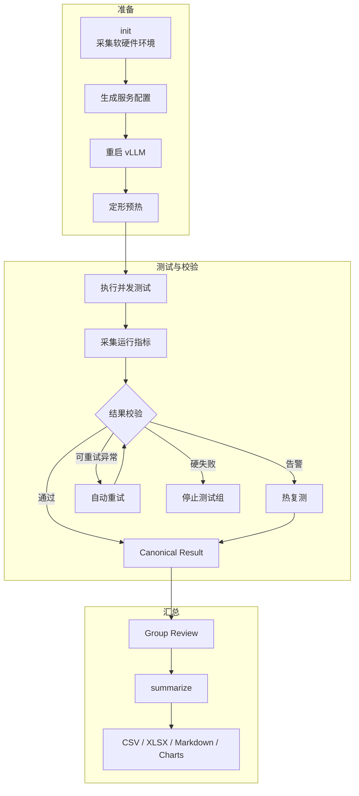

# Qwen3.6 27B vLLM-Ascend 性能基准与高并发参数调优

这是我在 Ascend NPU 上调优 vLLM 的实验记录，也是一套可以重复运行的 benchmark 脚本。我主要想弄清楚一件事：`max-num-seqs`、`max-num-batched-tokens`、输入长度和并发变化后，吞吐、TTFT、TPOT 与排队时间会怎么变。

脚本会采集运行环境，生成服务配置并重启 vLLM，完成预热后重复测试，同时记录运行指标。异常结果会自动复测，最后统一生成 CSV、XLSX、Markdown 报告和图表。目前仓库归档了 9 组服务配置、90 个测试场景和 270 条 canonical 结果。

生产 Baseline 是 `max-num-seqs=16`、`max-num-batched-tokens=8192`。这批数据里最明显的问题不是 KV cache 不够，而是 `max-num-seqs` 小于实际并发，很多请求只能排队。

## 实验系统架构



仓库中各部分的分工如下：

- `configs/experiment.yaml`：唯一的实验矩阵配置源；Shell 和 Python 均从这里读取参数。
- `scripts/bench_matrix.sh`：管理初始化、服务配置、预热、测试和分组执行。
- `scripts/bench_report.py`：解析指标、判定异常、选择 canonical 结果并生成报告。
- `scripts/plot_results.py`：从中位数汇总生成 README 图表。
- `tests/`：验证参数修改、异常分类、重复结果聚合和报告结构。
- `results/`：保存脱敏后的 canonical 结果、中位数汇总和图表。

## 测试矩阵

| 维度 | 测试值 |
|---|---|
| `max-num-seqs` | 16、24、32 |
| `max-num-batched-tokens` | 8192、12288、16384 |
| 输入长度 | 1024、4096 tokens |
| 输出长度 | 1024 tokens |
| 并发 | 1、5、10、16、32 |
| 每个场景重复次数 | 3 |
| 聚合方式 | 三次结果中位数 |

为了让不同配置可以直接比较，测试使用固定长度的随机输入、固定 seed、温度 0、`request-rate=inf` 和 `ignore-eos`。每个场景发送 `5 × concurrency` 个请求。这里测的是突发负载下的系统上限，不是对真实业务流量的模拟。

整轮实验实际执行了 434 次，留下 270 条 canonical 结果，汇总后是 90 行中位数数据。请求失败、抢占和被排除结果都是 0。

## 核心结果

### 1. 吞吐随并发变化


并发不超过 16 时，三种 `max-num-seqs` 差别不大。并发升到 32 后，`max-num-seqs=16` 的吞吐开始回落，`max-num-seqs=32` 仍能继续上升。

### 2. 首 Token 延迟随并发变化


把 `max-num-seqs` 提到 32 可以解决排队，但解决不了所有延迟问题。长输入下的 P95/P99 TTFT 仍会明显增长。

### 3. 单 Token 延迟


并发越高，总吞吐通常越高，但单个请求生成一个 Token 所需的时间也在增加。TPOT 可以看出这笔交换什么时候开始不划算。

### 4. 排队与调度上限


32 并发下，把 `max-num-seqs` 从 16 提到 32 后，平均排队时间大幅下降。`waiting_peak` 容易受瞬时采样影响，单独看它很容易误判，需要和 queue mean、TTFT 放在一起判断。

补充视图：


## 我从结果里看到什么

1. 高并发场景应该先调 `max-num-seqs`。32 并发下，将它从 16 提到 32，跨输入长度和 batched-token 配置的平均吞吐从 `511` 增至 `796 tok/s`，平均 P50 TTFT 从 `31.55` 秒降至 `1.18` 秒。
2. 单纯增大 `max-num-batched-tokens` 没有带来稳定收益。三个测试值的跨场景平均吞吐分别是 `367.74`、`365.56` 和 `360.89 tok/s`。更实际的顺序是先确定并发上限，再按输入长度微调。
3. 全矩阵的吞吐峰值是 `849.42 tok/s`，对应 `max-num-seqs=32`、`max-num-batched-tokens=12288`、输入 1024、并发 32。不过长输入、高并发时的尾延迟依然明显，峰值吞吐不是唯一目标。

## 从 Baseline 到候选配置

生产 Baseline 是 `seq=16, batched-tokens=8192`。如果一套服务需要同时处理 1024 和 4096 两种输入，我会把 `seq=32, batched-tokens=16384` 作为候选配置。它在 4096 输入下吞吐最高，在 1024 输入下也只比全矩阵峰值低约 0.5%，没有必要为两种输入分别维护配置。

下表比较相同硬件、模型、输出长度和 32 并发下的三次测试中位数：

| 输入 | 指标 | 生产 Baseline `16/8192` | 候选配置 `32/16384` | 变化 |
|---:|---|---:|---:|---:|
| 1024 | Output throughput | 517.20 tok/s | 844.89 tok/s | **+63.4%** |
| 1024 | P50 TTFT | 31.75 s | 0.73 s | **-97.7%** |
| 1024 | P99 TTFT | 36.50 s | 4.29 s | **-88.2%** |
| 1024 | Mean TPOT | 28.98 ms | 33.91 ms | +17.0% |
| 1024 | Queue mean | 27.63 s | 0.01 s | **-100.0%** |
| 4096 | Output throughput | 504.13 tok/s | 766.02 tok/s | **+52.0%** |
| 4096 | P50 TTFT | 31.87 s | 1.37 s | **-95.7%** |
| 4096 | P99 TTFT | 43.12 s | 15.58 s | **-63.9%** |
| 4096 | Mean TPOT | 29.46 ms | 36.83 ms | +25.0% |
| 4096 | Queue mean | 28.56 s | 0.93 s | **-96.7%** |

调整后的吞吐更高，排队也基本消失，代价是 TPOT 上升约 17%–25%。它更适合看重高并发吞吐的业务。如果单请求生成速度更重要，限制并发会比继续追峰值吞吐更合适。

## 工作负载选型

| 工作负载 | 候选配置 | 实测吞吐 | P50 TTFT |
|---|---|---:|---:|
| 并发不超过 16 | `seq=16, batched-tokens=8192` | 最高约 561–571 tok/s | 约 0.67–1.23 s |
| 1024 输入、32 并发 | `seq=32, batched-tokens=12288` | 849.42 tok/s | 1.16 s |
| 4096 输入、32 并发 | `seq=32, batched-tokens=16384` | 766.02 tok/s | 1.37 s |

表里的配置只在当前实验条件下成立。上线前仍要用真实流量和业务 SLO 验证。

## 如何复现

依赖：Bash 4+、Docker、Docker Compose、Python 3.9+、`curl`、`gzip`、PyYAML 和 `openpyxl`。生成图表还需要 Matplotlib。

```bash
# 指向现有的 vLLM Compose 服务目录
export SERVICE_DIR=/path/to/vllm-service
export CONTAINER_NAME=vllm
export COMPOSE_SERVICE=vllm

# 按需修改唯一的实验矩阵配置
cat configs/experiment.yaml

# 初始化测试并采集环境，命令会返回 RUN_DIR
./scripts/bench_matrix.sh init

# 执行一个参数组
./scripts/bench_matrix.sh group RUN_DIR MAX_NUM_SEQS MAX_NUM_BATCHED_TOKENS

# 生成最终报告
./scripts/bench_matrix.sh summarize RUN_DIR

# 从已归档的 summary_median.csv 重新生成图表
python3 scripts/plot_results.py
```

本地验证：

```bash
python -m unittest -v tests.test_bench_report
bash tests/test_bench_matrix.sh
```

结果入口：

- [实验矩阵配置](configs/experiment.yaml)；每条结果均保存该文件的 SHA256，防止混合不同配置的结果。
- [90 行中位数汇总](results/summary_median.csv)
- [270 条脱敏 canonical 结果](results/valid_results.csv)
- [可视化图表](results/figures/)

## 实验环境

这些信息来自测试初始化时保存的环境快照。公开版本已经去掉服务器地址、主机名、内部路径和容器名称。

| 类别 | 配置 |
|---|---|
| NPU | 8 × Ascend 910B4-1，单卡 64 GiB HBM |
| 基准服务并行度 | Tensor Parallel = 4 |
| CPU | 192 核 Kunpeng 920 |
| 内存 | 1 TiB |
| OS | openEuler 22.03 LTS，aarch64 |
| Ascend Driver / Firmware | 26.0.rc1 |
| CANN | 9.0.0 |
| Python | 3.12.13 |
| vLLM | 0.21.0 |
| vLLM-Ascend | 0.21.0rc1 |
| Docker | 27.0.1 |
| Docker image | `sha256:d01163b6517362feba9d4896358952b4c28a4eaf529c98a0d8e95e4c0f2044b7` |
| Model | Qwen3.6 27B |

## 异常判定

每次测试都会检查请求是否完整、输入输出长度是否符合预期，以及服务有没有报错、重启或 OOM。KV cache、抢占、等待队列、计数器、指标采样和预热状态也会一起检查。

请求失败、OOM、服务重启和等待停滞属于硬失败。KV cache 使用率超过 85% 只记容量告警，preemption 记为性能退化或容量告警；它们本身不会让结果失效。

当 `P99 TTFT > 3 × mean TTFT` 时，脚本会记录 `tail_latency_warning` 并立即热复测，但不会仅凭这一项排除结果。这里的 `valid` 只表示测试完整且没有硬失败，不等于满足生产延迟 SLO。

## 局限性

- 使用随机输入，没有覆盖真实业务提示词分布。
- 输入和输出长度固定，没有测试混合长度流量。
- `request-rate=inf` 模拟突发请求，不代表稳定到达流量。
- 强制输出 1024 tokens，不代表真实对话的回复长度。
- 每个场景仅重复三次，适合参数筛选，不足以替代长期稳定性测试。
- 当前结果来自单台机器，不能直接外推至其他硬件和软件版本。
- 原始环境快照没有记录 PyTorch、torch-npu 和模型 revision，后续复测应补采这三项。
- 公开归档不包含完整环境快照、服务日志和原始指标采样，因此可以复算汇总，但暂时不能完全独立验证原始测量。
