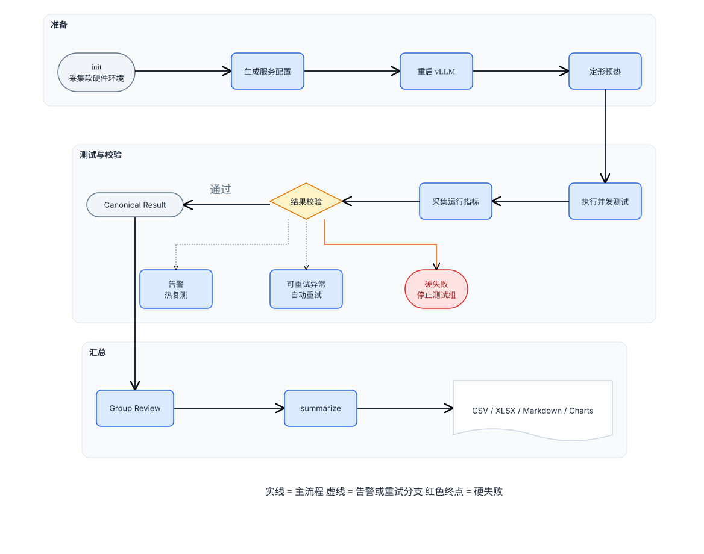
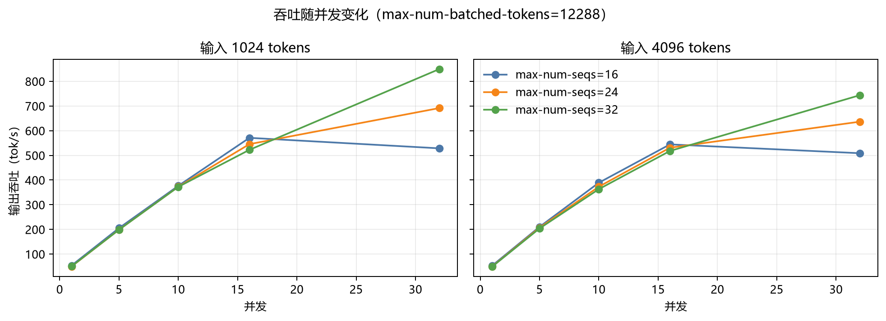
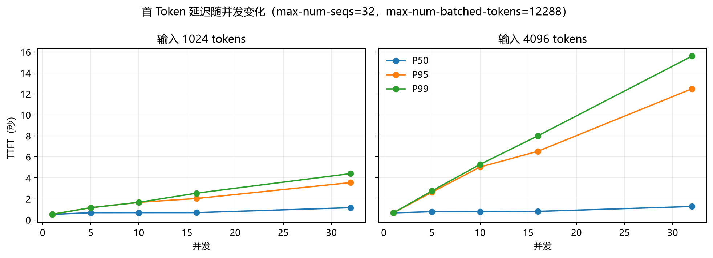
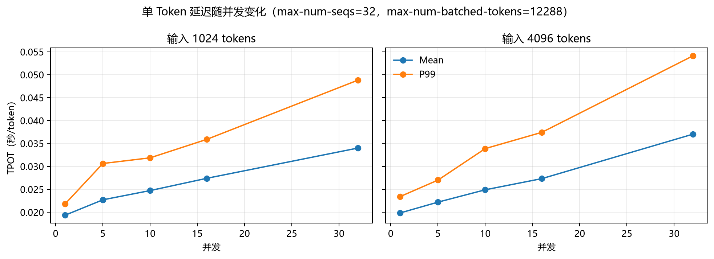
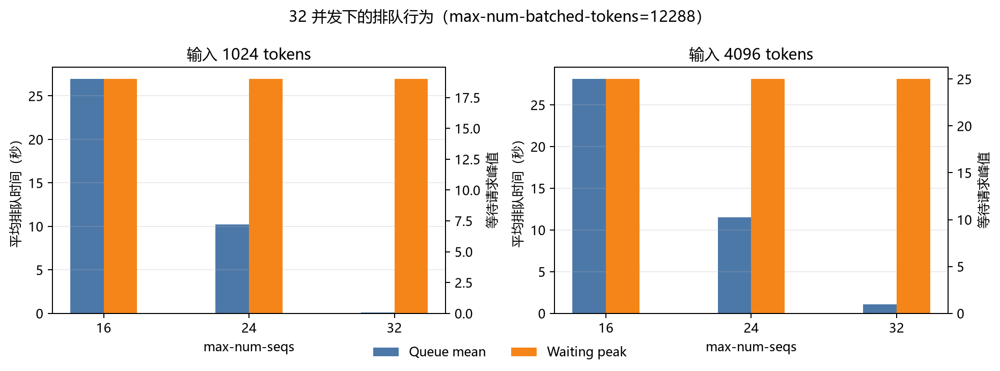
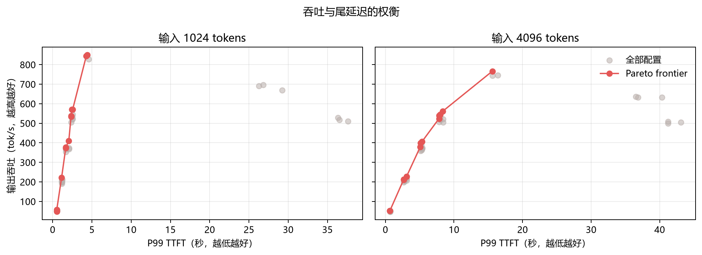

# Qwen3.6-27B vLLM-Ascend Serving 与执行机制性能优化

> 本项目分两个阶段：
> - **阶段一（已完成）**：高并发 Serving 参数调优 —— `max-num-seqs` / `max-num-batched-tokens` 扫描，得到 `32/16384` 候选配置。
> - **阶段二（已完成）**：在固定 `32/16384` 基线上完成执行机制消融与 CPU/NPU Profiler；最终保留 async、MTP=3 和 `FULL_DECODE_ONLY`。
>
> 完整计划见 [`PROJECT_PLAN.md`](PROJECT_PLAN.md)。

这是我在 Ascend NPU 上调优 vLLM 的实验记录，也是一套可以重复运行的 benchmark 脚本。阶段一主要回答：`max-num-seqs`、`max-num-batched-tokens`、输入长度和并发变化后，吞吐、TTFT、TPOT 与排队时间会怎么变。阶段二在阶段一得到的候选配置上，进一步回答框架执行机制（异步调度、投机解码、图模式）对吞吐与延迟的贡献，以及瓶颈在哪里。

脚本会采集运行环境，生成服务配置并重启 vLLM，完成预热后重复测试，同时记录运行指标。异常结果会自动复测，最后统一生成 CSV、XLSX、Markdown 报告和图表。目前仓库归档了 9 组服务配置、90 个测试场景和 270 条 canonical 结果。

生产 Baseline 是 `max-num-seqs=16`、`max-num-batched-tokens=8192`。这批数据里最明显的问题不是 KV cache 不够，而是 `max-num-seqs` 小于实际并发，很多请求只能排队。

## 实验环境

这些信息来自测试初始化时保存的环境快照。公开版本已经去掉服务器地址、主机名、内部路径和容器名称。

| 类别 | 配置 |
|---|---|
| NPU | 8 × Ascend 910B4-1，单卡 64 GiB HBM |
| 基准服务并行度 | Tensor Parallel = 4 |
| CPU | 192 核 Kunpeng 920 |
| 内存 | 1 TiB |
| OS | openEuler 22.03 LTS，aarch64 |
| Ascend Driver / Firmware | 26.0.rc1 |
| CANN | 9.0.0 |
| Python | 3.12.13 |
| vLLM | 0.21.0 |
| vLLM-Ascend | 0.21.0rc1 |
| Docker | 27.0.1 |
| Docker image | `sha256:d01163b6517362feba9d4896358952b4c28a4eaf529c98a0d8e95e4c0f2044b7` |
| Model | Qwen3.6-27B |

## 实验系统架构

[](docs/architecture.drawio)

仓库中各部分的分工如下：

- `configs/experiment.yaml`：唯一的实验矩阵配置源；Shell 和 Python 均从这里读取参数。
- `scripts/bench_matrix.sh`：管理初始化、服务配置、预热、测试和分组执行。
- `scripts/bench_report.py`：解析指标、判定异常、选择 canonical 结果并生成报告。
- `scripts/plot_results.py`：从中位数汇总生成 README 图表。
- `tests/`：验证参数修改、异常分类、重复结果聚合和报告结构。
- `results/`：保存脱敏后的 canonical 结果、中位数汇总和图表。

## 测试矩阵

| 维度 | 测试值 |
|---|---|
| `max-num-seqs` | 16、24、32 |
| `max-num-batched-tokens` | 8192、12288、16384 |
| 输入长度 | 1024、4096 tokens |
| 输出长度 | 1024 tokens |
| 并发 | 1、5、10、16、32 |
| 每个场景重复次数 | 3 |
| 聚合方式 | 三次结果中位数 |

为了让不同配置可以直接比较，测试使用固定长度的随机输入、固定 seed、温度 0、`request-rate=inf` 和 `ignore-eos`。每个场景发送 `5 × concurrency` 个请求。这里测的是突发负载下的系统上限，不是对真实业务流量的模拟。

整轮实验实际执行了 434 次，留下 270 条 canonical 结果，汇总后是 90 行中位数数据。请求失败、抢占和被排除结果都是 0。

## 核心结果

### 1. 吞吐随并发变化



并发不超过 16 时，三种 `max-num-seqs` 差别不大。并发升到 32 后，`max-num-seqs=16` 的吞吐开始回落，`max-num-seqs=32` 仍能继续上升。

### 2. 首 Token 延迟随并发变化



把 `max-num-seqs` 提到 32 可以解决排队，但解决不了所有延迟问题。长输入下的 P95/P99 TTFT 仍会明显增长。

### 3. 单 Token 延迟



并发越高，总吞吐通常越高，但单个请求生成一个 Token 所需的时间也在增加。TPOT 可以看出这笔交换什么时候开始不划算。

### 4. 排队与调度上限



32 并发下，把 `max-num-seqs` 从 16 提到 32 后，平均排队时间大幅下降。`waiting_peak` 容易受瞬时采样影响，单独看它很容易误判，需要和 queue mean、TTFT 放在一起判断。

补充视图：



## 我从结果里看到什么

1. 高并发场景应该先调 `max-num-seqs`。32 并发下，将它从 16 提到 32，跨输入长度和 batched-token 配置的平均吞吐从 `511` 增至 `796 tok/s`，平均 P50 TTFT 从 `31.55` 秒降至 `1.18` 秒。
2. 单纯增大 `max-num-batched-tokens` 没有带来稳定收益。三个测试值的跨场景平均吞吐分别是 `367.74`、`365.56` 和 `360.89 tok/s`。更实际的顺序是先确定并发上限，再按输入长度微调。
3. 全矩阵的吞吐峰值是 `849.42 tok/s`，对应 `max-num-seqs=32`、`max-num-batched-tokens=12288`、输入 1024、并发 32。不过长输入、高并发时的尾延迟依然明显，峰值吞吐不是唯一目标。

## 从 Baseline 到候选配置

生产 Baseline 是 `seq=16, batched-tokens=8192`。如果一套服务需要同时处理 1024 和 4096 两种输入，我会把 `seq=32, batched-tokens=16384` 作为候选配置。它在 4096 输入下吞吐最高，在 1024 输入下也只比全矩阵峰值低约 0.5%，没有必要为两种输入分别维护配置。

下表比较相同硬件、模型、输出长度和 32 并发下的三次测试中位数：

| 输入 | 指标 | 生产 Baseline `16/8192` | 候选配置 `32/16384` | 变化 |
|---:|---|---:|---:|---:|
| 1024 | Output throughput | 517.20 tok/s | 844.89 tok/s | **+63.4%** |
| 1024 | P50 TTFT | 31.75 s | 0.73 s | **-97.7%** |
| 1024 | P99 TTFT | 36.50 s | 4.29 s | **-88.2%** |
| 1024 | Mean TPOT | 28.98 ms | 33.91 ms | +17.0% |
| 1024 | Queue mean | 27.63 s | 0.01 s | **-100.0%** |
| 4096 | Output throughput | 504.13 tok/s | 766.02 tok/s | **+52.0%** |
| 4096 | P50 TTFT | 31.87 s | 1.37 s | **-95.7%** |
| 4096 | P99 TTFT | 43.12 s | 15.58 s | **-63.9%** |
| 4096 | Mean TPOT | 29.46 ms | 36.83 ms | +25.0% |
| 4096 | Queue mean | 28.56 s | 0.93 s | **-96.7%** |

调整后的吞吐更高，排队也基本消失，代价是 TPOT 上升约 17%–25%。它更适合看重高并发吞吐的业务。如果单请求生成速度更重要，限制并发会比继续追峰值吞吐更合适。

## 工作负载选型

| 工作负载 | 候选配置 | 实测吞吐 | P50 TTFT |
|---|---|---:|---:|
| 并发不超过 16 | `seq=16, batched-tokens=8192` | 最高约 561–571 tok/s | 约 0.67–1.23 s |
| 1024 输入、32 并发 | `seq=32, batched-tokens=12288` | 849.42 tok/s | 1.16 s |
| 4096 输入、32 并发 | `seq=32, batched-tokens=16384` | 766.02 tok/s | 1.37 s |

表里的配置只在当前实验条件下成立。上线前仍要用真实流量和业务 SLO 验证。

## 如何复现

依赖：Bash 4+、Docker、Docker Compose、Python 3.9+、`curl`、`gzip`、PyYAML 和 `openpyxl`。生成图表还需要 Matplotlib。

```bash
# 指向现有的 vLLM Compose 服务目录
export SERVICE_DIR=/path/to/vllm-service
export CONTAINER_NAME=vllm
export COMPOSE_SERVICE=vllm

# 按需修改唯一的实验矩阵配置
cat configs/experiment.yaml

# 初始化测试并采集环境，命令会返回 RUN_DIR
./scripts/bench_matrix.sh init

# 执行一个参数组
./scripts/bench_matrix.sh group RUN_DIR MAX_NUM_SEQS MAX_NUM_BATCHED_TOKENS

# 生成最终报告
./scripts/bench_matrix.sh summarize RUN_DIR

# 从已归档的 summary_median.csv 重新生成图表
python3 scripts/plot_results.py
```

结果入口：

- [实验矩阵配置](configs/experiment.yaml)；每条结果均保存该文件的 SHA256，防止混合不同配置的结果。
- [90 行中位数汇总](results/summary_median.csv)
- [270 条脱敏 canonical 结果](results/valid_results.csv)
- [可视化图表](results/figures/)

## 阶段二：执行机制消融与 Profiling

阶段二在固定 `32/16384` 基线上，对三类执行机制做单变量消融，覆盖两种工作负载（prefill-heavy ≈4096 tok / decode-heavy ≈1024 tok），每种配置重复 3 次，共 24 个结果。

| 配置 | 变更（单变量） | 验证目标 |
|---|---|---|
| `BASE` | 无（async on + MTP on + FULL_DECODE_ONLY） | 对照基线 |
| `ASYNC_OFF` | 关闭 `--async-scheduling` | 异步调度对吞吐/尾延迟贡献 |
| `MTP_OFF` | 移除 `--speculative_config` | 投机解码接受率与净收益 |
| `EAGER` | `cudagraph_mode=NONE` | 图模式对 decode 吞吐贡献 |

实验通过 [`expected_manifest.json`](configs/expected_manifest.json) 固定软件、模型和硬件环境，每轮只改一个执行机制。各配置按 [`execution_ablation.yaml`](configs/execution_ablation.yaml) 轮换运行，避免运行先后和机器温度持续偏向某一组。结果统一按 [`analysis_rules.yaml`](configs/analysis_rules.yaml) 判断，其中阈值来自阶段一的 270 条历史结果。

两类工作负载使用同一批固定 prompt，内容和精确 token 数记录在 [`prompts/manifest.json`](results/execution_ablation/prompts/manifest.json)：

- `prefill_heavy`：64 条，token 最小值/中位数/最大值为 3703 / 3926 / 4327。
- `decode_heavy`：64 条，token 最小值/中位数/最大值为 985 / 1020 / 1063。

运行入口（内部执行固定使用同一台 TP=4 / NPU 0–3 服务器；公开命令只保留环境变量）：

```bash
export SERVICE_DIR=/path/to/vllm-service
export CONTAINER_NAME=vllm
export COMPOSE_SERVICE=vllm
export BENCH_PYTHON=/path/to/python3

# 初始化并渲染消融矩阵（输出 ABLATION_* 变量供 bench_matrix.sh 消费）
python3 scripts/bench_report.py config-ablation --config configs/execution_ablation.yaml

# 执行整轮消融：init 即触发完整循环（init → 按轮换顺序 group → 每 case 采集+判定）
./scripts/bench_execution_ablation.sh init
```

24/24 次正式运行有效；汇总见 [`summary.csv`](results/execution_ablation/summary.csv)，逐次结果见 [`raw.csv`](results/execution_ablation/raw.csv)。

| 配置 | Decode 吞吐 vs BASE | Decode TPOT vs BASE | Prefill 吞吐 vs BASE | 决策 |
|---|---:|---:|---:|---|
| `ASYNC_OFF` | +2.12% | -0.51% | -1.35% | 低于 5% 效应量，保留 async |
| `MTP_OFF` | -18.64% | +21.78% | -30.05% | 回归，保留 MTP=3 |
| `EAGER` | -63.77% | +175.08% | -67.76% | 严重回归，保留图模式 |

正确性 guardrail：MTP on/off 仅 3/8 请求精确 token 一致，故不推荐 `MTP_OFF`；证据见 [`correctness.csv`](results/execution_ablation/correctness.csv)。Profiler 显示 EAGER 的 HCCL 汇总时间约为 BASE 的 17.6 倍、Host launch 次数约 2.40 倍；聚合见 [`exported_metrics.csv`](results/profiling/exported_metrics.csv)，完整解释见 [`execution_optimization.md`](docs/execution_optimization.md)。

最终链路：`16/8192`（生产 baseline）→ `32/16384`（阶段一，1024/1024、C32 吞吐 +63.4%）→ 保持 async on、MTP=3、`FULL_DECODE_ONLY`（阶段二 final）。结论限于 TP=4、NPU 0–3、突发 concurrency=32；不外推低 QPS 或其他模型。

> 状态：P1–P4 实验完成；49 项本地测试全绿。大型 Profiler 原始报告留在远端，仓库保存脱敏 CSV、图和 SHA256。

## 量化 A/B：W8A8 vs BF16（Qwen3.8-27B，910B4 TP=4）

同机 8 卡两实例各占 4 卡，服务参数全同（`32/16384`、MTP=3、`FULL_DECODE_ONLY`），唯一差异 `--quantization=ascend`。
T1 矩阵 `in∈{1024,4096} × c∈{1,8,32} × out=512 × 3 次取中位`，36/36 次有效、0 failed、0 preemption；
判定沿用阶段二规则（效应量 ≥5% 且 3/3 同向；guardrail 回退 >3% 不推荐）。Δ 为 W8A8 相对 BF16：

| in | c | 输出吞吐 BF16 / W8A8 (tok/s) | 吞吐 Δ | mean TPOT Δ | P99 TTFT Δ |
|---:|---:|---|---:|---:|---:|
| 1024 | 1 | 91.87 / 75.21 | **−18.1%** | +23.6% | +6.2% |
| 1024 | 8 | 393.9 / 379.2 | −3.7% | +3.5% | +18.9%（2/3 同向） |
| 1024 | 32 | 725.1 / 733.7 | +1.2% | −0.7% | −6.3% |
| 4096 | 1 | 79.50 / 71.64 | **−9.9%** | +12.3% | +2.4% |
| 4096 | 8 | 264.6 / 281.1 | +6.2%（2/3） | +6.2%（1/3） | **−60.9%** |
| 4096 | 32 | 449.3 / 432.5 | −3.7%（1/3） | +1.9%（1/3） | −5.3%（1/3） |

1. 单流（c=1）BF16 明确更优，吞吐与 TPOT 双 guardrail 同向触发——延迟敏感负载不必迁 W8A8。
2. c=32 等价（差 <4%）；W8A8 唯一稳定优势是 `4096/c8` 尾延迟：P99 TTFT −60.9%、P99 E2EL −23%。
3. T3 kernel 归因（c=1，torch profiler rank0，见 `profiling_metadata.md`）：W8A8 kernel 总时间 −21%、
   MatMul 路径 −29%（`DynamicQuant` 仅占 4.5%），但非重叠通信 +50%
   —— quant→QMM→dequant 依赖链破坏计算/通信重叠，**算力不是瓶颈**；高并发流水打满后差距消失，与 T1 自洽。

数据：[`results/quant_ab/`](results/quant_ab/) —— `summary.csv`（中位数 + 全指标 `_vs_base_pct`，对齐 execution_ablation schema）、
`raw.csv`（36 次逐 attempt）、T3 见 `op_statistic_*.csv` / `step_trace_*.csv`。
> 状态：T1/T3 完成。T2（c∈{16,24}、out=1024）、262144 长上下文与贪心 token 一致性（见 quant-eval 仓库）未测；
> 大型 trace 与原始 profiler 产物留存于采集节点，仓库只入脱敏聚合。

## 相关仓库

- 精度评测（Qwen3.8-27B，W8A8 vs BF16，配对检验 + PPL 哨兵）：
  [vllm-ascend-quant-eval](https://github.com/ash934141435/vllm-ascend-quant-eval)

## 免责声明

本实验为个人研究项目，不包含任何客户数据或公司内部资产；所用模型、数据集与工具均为公开资源，公开版本已移除服务器地址、主机名、内部路径与容器名称。结论仅反映上述特定版本、镜像与硬件组合下的测量结果，不代表任何厂商的官方立场。
